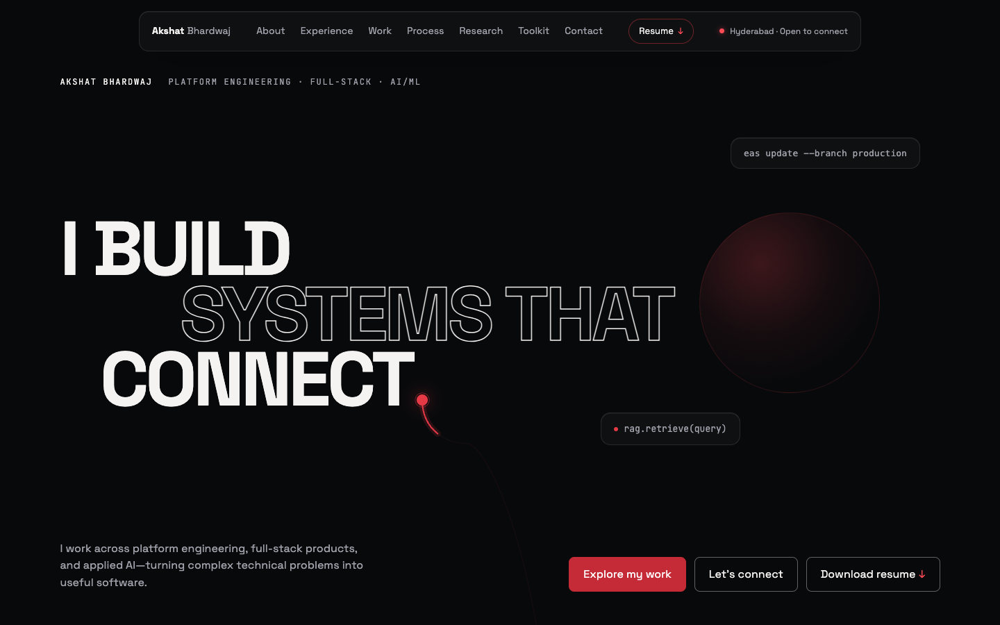
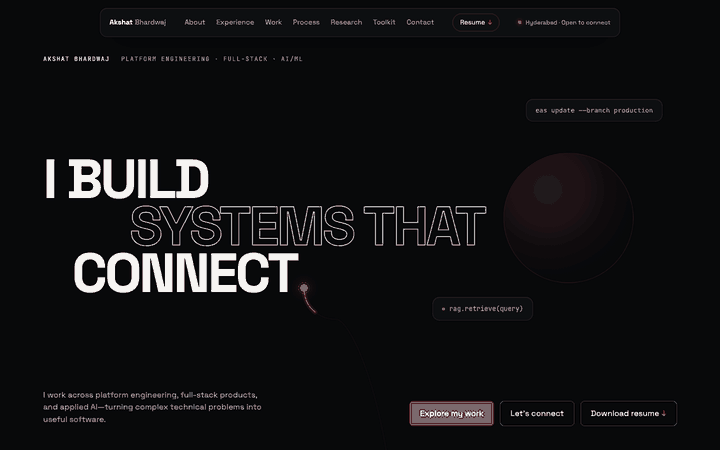
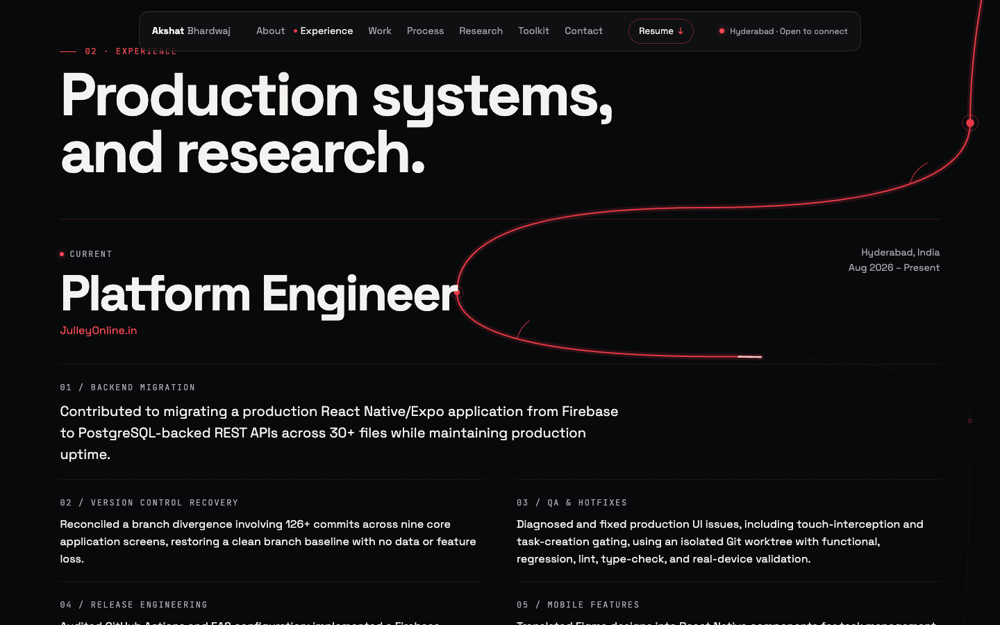
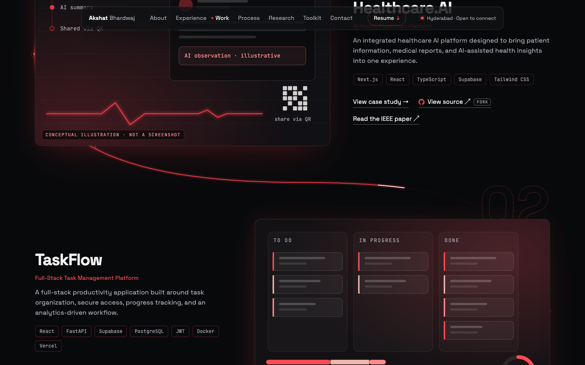
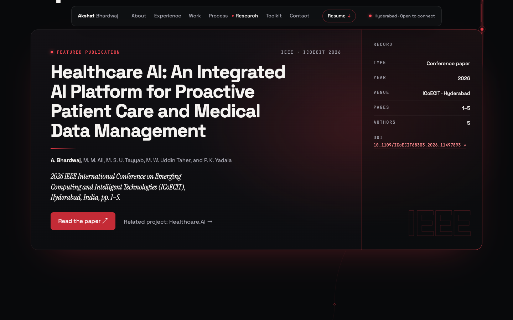
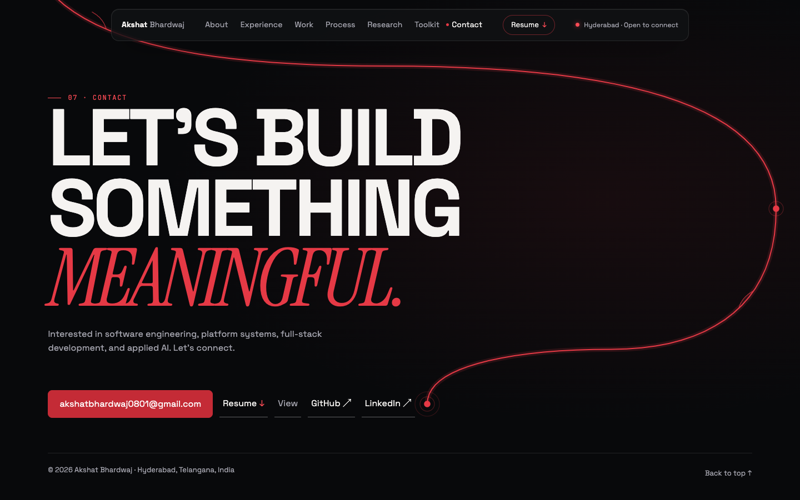
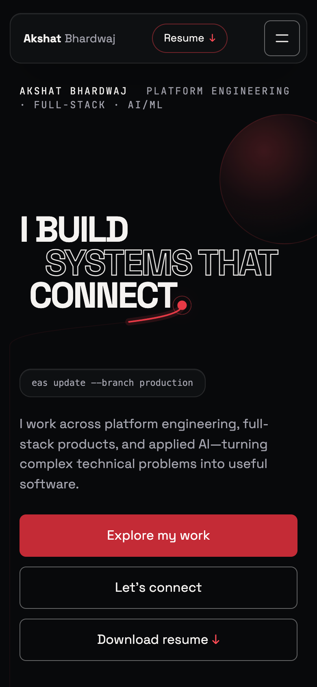
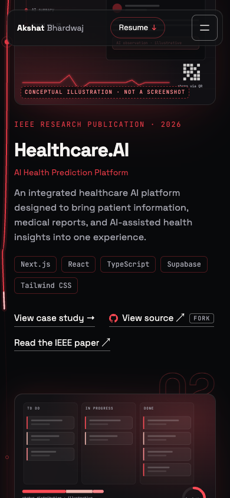

# Akshat Bhardwaj — Portfolio

A single-page personal portfolio for **Akshat Bhardwaj**, a platform engineer and Computer Science undergraduate in Hyderabad, India. It covers platform engineering, full-stack products and applied AI, including a published IEEE paper.

One crimson line, drawn as you scroll, runs from the full stop of the hero headline through every section to the contact links.

> **Status:** source only. The site has not been deployed yet, and search indexing is turned off (`noindex` meta tag and `Disallow: /` in `robots.txt`).



## Design identity: Black × Crimson

- **Palette:** a deep black base (`#08090B`) with layered dark surfaces, warm off-white text and one crimson accent family (`#E53945`, `#FF4B55`, `#C42B36`). All colours are tokens on `:root` in [`src/index.css`](src/index.css).
- **The line:** one organic crimson path ([`NerveLine.tsx`](src/components/NerveLine.tsx)). It anchors to headings, cards and links, draws in step with the scroll, lights nodes as it reaches them and reverses when you scroll back. It is routed through the gutters and the gaps between blocks, around body text.
- **Typography:** Space Grotesk for display and body, Instrument Serif italics for accents, JetBrains Mono for labels.
- **Motion:** smooth scrolling (Lenis), a scrubbed hero exit, and staggered section reveals. Everything is static when the visitor prefers reduced motion.
- **Illustrations:** project visuals are conceptual drawings built in code and labelled as conceptual. They are not product screenshots.

## The line in motion

The line is tied to scroll position, so it is easiest to see moving. The clip below is a **frame-based scroll-sequence preview, not a real-time screen recording**: 70 browser screenshots taken at successive scroll positions (64 px apart), played back at about 11 frames per second. It steps through the hero, About and Experience, on to the second project (TaskFlow), and nothing is drawn over the frames.



The frames below were captured with animation on, partway through the scroll.

| Experience: milestones and branches | Projects: the line between cards |
| --- | --- |
|  |  |
| **Research: the featured IEEE paper** | **Contact: where the line ends** |
|  |  |

More frames, and full-page captures at 1440, 1024, 768 and 390 px, are indexed in [`docs/screenshots/`](docs/screenshots/README.md). Those full-page captures use reduced motion so the whole line is drawn at once.

 &nbsp; 

## Features

- **Hero:** “I build systems that connect.” Calls to action: explore work, get in touch, download the resume.
- **About:** capability summary (platform & engineering, full-stack products, AI & research).
- **Experience:** Platform Engineer at JulleyOnline.in, plus AI research internships at Swecha Telangana (IIIT Hyderabad) and Agnirva.com.
- **Selected projects:** four projects, each with a full case study (opened by URL, e.g. `#/work/taskflow`) and a **View source** link to its GitHub repository.
- **How I work:** four stages, from understanding a system to validating a change.
- **Research & recognition:** a featured card for the IEEE ICoECIT 2026 paper with its DOI, plus a paper presentation, a hackathon win and a certification.
- **Technical toolkit and contact:** email, GitHub, LinkedIn and resume.
- **Accessibility:** skip link, keyboard focus states, focus-trapped menu and case-study dialogs, screen-reader labels for external links and downloads, and full reduced-motion support.
- **Responsive:** tested at 1440, 1024, 768 and 390 px wide.

## Projects

| Project | What it is | Technologies found in the repository | Source |
| --- | --- | --- | --- |
| **Healthcare.AI** | A health monitoring and management platform: a patient dashboard, an AI health assistant, report storage with QR-code sharing, caretaker reminders and a health timeline. Basis of the IEEE paper below. | Next.js 14 (App Router), React 18, TypeScript, Tailwind CSS, Supabase, Drizzle ORM, Framer Motion, QR-code libraries, Chart.js and Recharts. AI answers come from hosted LLM APIs (Google Gemini, DeepSeek). | [HealthCare.Ai](https://github.com/AKSHAT-BHARDWAJ01/HealthCare.Ai) (fork of `murtuza777/HealthCare.Ai`) |
| **TaskFlow** | A full-stack task management app with registration and login, task workflows, reminders and analytics. | React 19, Vite, Chart.js, GSAP, Lenis; FastAPI, SQLAlchemy, JWT (python-jose), bcrypt; SQLite locally and PostgreSQL on Supabase in production; Docker; Vercel. Tests use Python `unittest` and Node's built-in test runner. | [task-management-app](https://github.com/AKSHAT-BHARDWAJ01/task-management-app) |
| **Burry AI** | An AI finance manager for students, with a dashboard and a listings feed of opportunities. | Next.js 14, React 18, TypeScript, Tailwind CSS, Three.js, Chart.js, Framer Motion; Cloudflare Workers with Hono and Zod; Cloudflare D1; Cloudflare Workers AI; JWT (jose), bcryptjs; Vitest. | [BurryAI](https://github.com/AKSHAT-BHARDWAJ01/BurryAI) (fork of `murtuza777/BurryAI`) |
| **Webopedia** | An accessible Wikipedia client with search, text-to-speech, a floating action button and auto-scroll. Won 1st place at Hack-O-Mania (2023) with Team Blaze. The repository calls it Wajipedia. | HTML, CSS and vanilla JavaScript; the Wikipedia API; the Web Speech API (speech synthesis). | [Wikipedia_HackOmania](https://github.com/AKSHAT-BHARDWAJ01/Wikipedia_HackOmania) (fork of `murtuza777/Wikipedia_HackOmania`) |

The technologies listed are the ones found in each repository's package manifests and source. The project visuals on the site are conceptual illustrations, not screenshots of these applications.

**About the repositories:** TaskFlow is my own repository. HealthCare.Ai, BurryAI and Wikipedia_HackOmania are my forks of repositories by `murtuza777`. Their history is mostly the upstream team's, and is not presented here as my individual work. The site labels these links as forks, and each case study names the upstream repository.

**Publication:** A. Bhardwaj, M. M. Ali, M. S. U. Tayyab, M. W. Uddin Taher and P. K. Yadala, “Healthcare AI: An Integrated AI Platform for Proactive Patient Care and Medical Data Management,” 2026 IEEE International Conference on Emerging Computing and Intelligent Technologies (ICoECIT), Hyderabad, India, pp. 1–5. DOI: [10.1109/ICoECIT68303.2026.11497893](https://doi.org/10.1109/ICoECIT68303.2026.11497893)

## Resume

A two-page, ATS-friendly resume is served at [`public/resume/Akshat_Bhardwaj_Resume.pdf`](public/resume/Akshat_Bhardwaj_Resume.pdf). The site links to it from the hero, the navigation and the contact section.

- **Text:** embedded Unicode fonts, so the text is selectable and searchable.
- **Links:** email, LinkedIn, GitHub, project repositories and the DOI are all clickable.
- **Privacy:** the public copy has no phone number.
- **Source:** the PDF is generated from [`resume-src/resume.html`](resume-src/resume.html) with Chromium's print-to-PDF (US Letter).

## Technologies

| Area | Tools |
| --- | --- |
| UI | React 19, TypeScript 5 |
| Build | Vite 8 |
| Styling | Tailwind CSS 4 (via `@tailwindcss/vite`) and hand-written CSS with design tokens |
| Motion | GSAP 3 (ScrollTrigger), Lenis |
| Fonts | Google Fonts: Space Grotesk, Instrument Serif, JetBrains Mono |

## Project structure

```text
.
├── index.html                # page shell, fonts, noindex meta tag
├── public/
│   ├── favicon.svg
│   ├── robots.txt            # Disallow: / (indexing off)
│   └── resume/
│       └── Akshat_Bhardwaj_Resume.pdf
├── resume-src/
│   └── resume.html           # source of the resume PDF
├── src/
│   ├── main.tsx              # entry point
│   ├── App.tsx               # page sections
│   ├── content.ts            # all copy, links, project data, repository URLs
│   ├── index.css             # design tokens and styles
│   ├── components/
│   │   ├── Nav.tsx           # navigation and mobile menu
│   │   ├── NerveLine.tsx     # the scroll-drawn crimson line
│   │   ├── CaseStudy.tsx     # project case-study dialog
│   │   └── ProjectVisual.tsx # conceptual project illustrations
│   └── lib/
│       ├── motion.ts         # Lenis, reveals, hero exit, project entrances
│       └── useFocusTrap.ts
├── docs/
│   ├── screenshots/          # screenshots of the production build, with an index
│   │   └── normal-motion/    # frames captured with animation on
│   └── media/
│       └── line-scroll.gif   # the line drawing as the page scrolls
├── package.json
├── tsconfig.json
└── vite.config.ts
```

Content lives in [`src/content.ts`](src/content.ts). Project repository links are in the `REPOS` map there; remove an entry to hide that project's **View source** link.

## Getting started

You need Node.js 20.19+ or 22.12+ (Vite 8's requirement). It was developed with Node 22.

```sh
git clone https://github.com/AKSHAT-BHARDWAJ01/portfolio-black-red.git
cd portfolio-black-red
npm ci            # install the exact versions in package-lock.json
npm run dev       # development server at http://localhost:5173
npm run build     # production build into dist/
npm run preview   # serve the production build at http://localhost:4173
npx tsc --noEmit  # type check
```

The build output in `dist/` is a static site. It is not hosted anywhere yet.

## Contact

- Email: [akshatbhardwaj0801@gmail.com](mailto:akshatbhardwaj0801@gmail.com)
- LinkedIn: [akshat-bhardwaj-84bb52271](https://www.linkedin.com/in/akshat-bhardwaj-84bb52271/)
- GitHub: [AKSHAT-BHARDWAJ01](https://github.com/AKSHAT-BHARDWAJ01)
